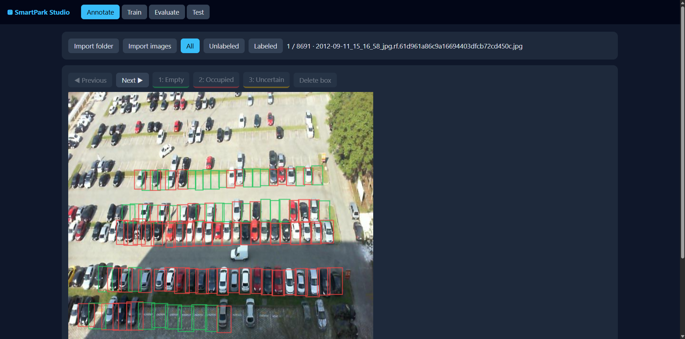
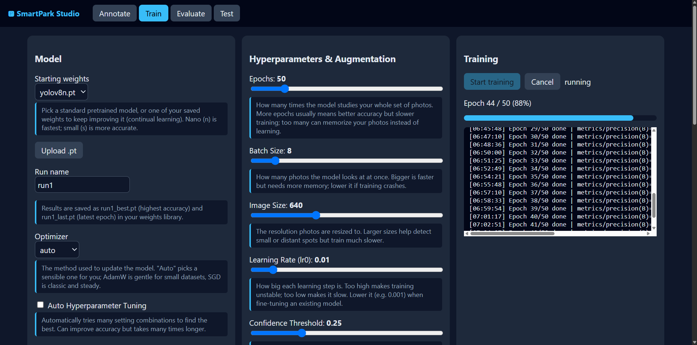
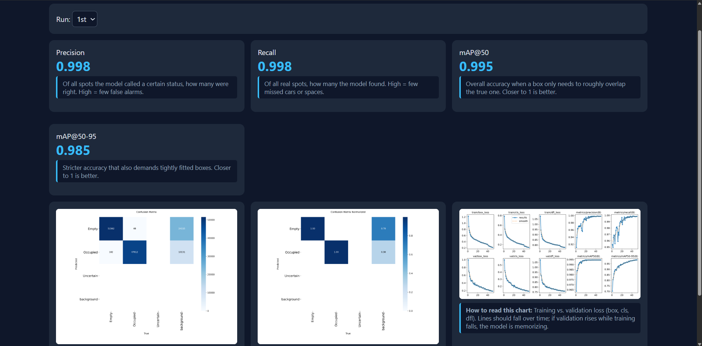
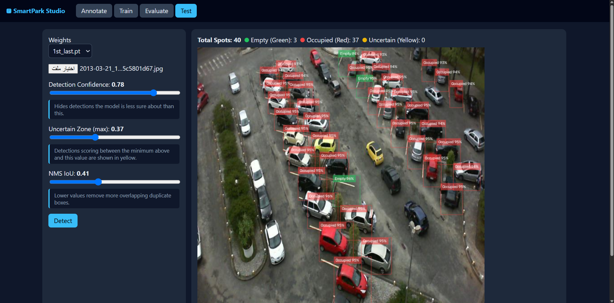

# SmartPark ML Studio
*A lightweight, local MLOps environment for custom YOLOv8 training and annotation.*

**Part of the SmartPark V2 Ecosystem**  
This tool was built as the foundational step in rebuilding my graduation project (SmartPark - 2nd Place Winner, Computer Science, Jazan University). To overcome the limitations of pre-trained models and cloud dependency, I developed this local studio. It empowers developers and non-technical users to annotate, train, evaluate, and test computer vision models entirely on their local machines.

## Features
- **End-to-End Pipeline:** Seamlessly flow through Annotate -> Train -> Evaluate -> Test within a single UI.
- **Local & Secure:** Zero cloud dependency. All datasets and model weights remain securely on your local hardware.
- **Optimized for YOLO:** Built explicitly to fine-tune YOLO models with custom hyperparameters.


## Studio Interfaces

**1. Annotation Workspace**  
*Quickly label objects with custom hotkeys to build a high-quality dataset.*


**2. Training Dashboard**  
*Monitor YOLOv8 training progress and view live metrics locally.*


**3. Evaluation Metrics**  
*Analyze model performance, precision, and recall after training.*


**4. Testing & Inference**  
*Upload test images and verify the model's real-world accuracy instantly.*



## Quick Start
Run the startup script based on your OS, then access the local server:
```bash
# Windows
start.bat

# Linux / Mac
./start.sh 
```
Then, open your browser and navigate to: http://127.0.0.1:8000

## Directory Structure
All user data is generated and stored locally in backend/workspace/:

/images & /labels: Your raw data and YOLO-format annotations.

/dataset: Auto-generated YAML configurations.

/runs & /weights: Training logs, charts, and saved model weights (.pt).


## Annotation Hotkeys
- 1 / 2 / 3: Quickly assign classes (e.g., Occupied, Empty, Uncertain).

- Del: Delete the selected bounding box.

- Arrow Keys: Navigate effortlessly between images.